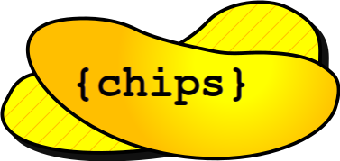

# The Chips language



Control of Hierarchical Interconnected Programmable Systems

## Why Chips?

Chips is a language to textually describe models of spatially structured systems.

It is a synchronous description language that is built upon the [BIP framework](https://www-verimag.imag.fr/TOOLS/DCS/bip/doc/latest/html/index.html). Chips models architectures is based on 3 elements:

1) A network specifying locations and the bridges linking them together,
2) A network specifying functions providing dataflows to each other,
3) A mapping of the functions onto the locations.

When designing models, data transfer between the functions can be parameterized by the bridges taken by the information, thus allowing an extremely versatile set of interactions between the components of the systems modeled.

Its toolchain being built using robust Model Driven Engineering methods and tools (EMF metamodels and ATL Model2Model transformations), we ensure the code generated from a Chips specification is correct regarding our language semantics (yet to be formalised). The so-said code is generated acknowledging the different nature of the model's elements.

The Chips language takes its root in the design of block schema representation of complex systems, and allows to modelize such systems with a syntax that mixes C-style definition of functions with dataflow logics.

## Chips typical usage

- Simulation of Block Diagram models according to Chips specification,
- Easy generation of large BIP models when their desired architecture matches the Chips semantics,
- C++ code generation for Chips Models to embark on real hardware,

## Current state of the project

- Chips 1.1 supported (handling collective operations for models including one function per node of interest)
- A forked version of the BIP compiler is provided. It has been modified to be able to either read ```.bip``` files or ```.xmi``` serialized BIP models. It is also integrated to the compile chain.


## Installation (On Unix based systems)

(Currently, no other OS is supported)

Before anything, make sure you have all the following software in a recent enough version (who still uses java 1.7 anyway?) installed on your machine:
``` 
git g++ gcc make cmake build-essential curl bash ant java realpath
```

Once all these softwares are installed with the method of your choic, open a terminal and run:
```bash
cd <path to your desired installation location>
git clone git@github.com:NwaitDev/Chips_Public.git
cd Chips_Public/ChipsCompiler
make # Compiles all the sources (Chips Parser + ATL transformations + BIP Compiler + CppProject generation)
cd FullCompileChain/BipCompiler/distribution
source setenv.sh
cd -
source setenv.sh # Defines Environment variables to run the compiler
make install
```
(the setenv.sh scripts require to be run for each instance of terminal you wish to use Chips in)

## Running the compiler

The compiler CLI is available in the form of a bash script called ```chipsc```:
```<Installation path>/Chips_Public/ChipsCompiler/chipsc```.

(the make install rule creates a simlink for this program in your PATH)

## Documentation Links

- [Users documentation](./documentation/UsersDocumentation/UD0_Introduction.md)
- [Developers documentation](./documentation/DevelopersDocumentation/DD0_Introduction.md)

## Upgrades for next versions of Chips 

- macros and constexpr
- generation of block diagrams PNG from Chips specs <3
- annotations for dimensionnal analysis
- object orientation of the language
- including enumerations
- syntaxic coloration and code snippets
- functions that are not functional blocks 
- collective operations supporting several targets per node
- proper libraries/packages management
- handling reconfigurations of the connexions of models elements

## License
I have no idea of what license to use, I'm just a poor little PhD student 

## Project status
Ongoing project