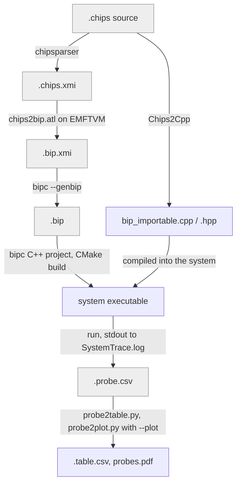

# Chips compiler architecture diagram

The toolchain is five programs chained by one bash runner:

- **chipsparser** (C++, ANTLR4): parses and type-checks Chips, writes an XMI model that conforms to `chips1.1.ecore`.
- **chips2bip.atl** (ATL on EMFTVM): transforms the Chips model into a BIP model that conforms to `BIP.ecore`.
- **Chips2Cpp** (C++, ANTLR4): generates the C++ bodies of the components' functions, including `probe` statements.
- **bipc** (BIP compiler): prints the BIP model as `.bip` text, then generates a C++/CMake project from it.
- **chipsc** (bash): runs every step, keeps a log per step, runs the system and post-processes its probes.

A `.chips` file runs the whole chain: the main column builds the BIP model, and Chips2Cpp generates the function bodies that bipc compiles into the same system. Any shaded file can be passed to `chipsc` to start from that point.

| Stop flag | Last file produced |
| --- | --- |
| `--chips-xmi` | `.chips.xmi` |
| `--bip-xmi` | `.bip.xmi` |
| `--bip` | `.bip` |
| `--cpp-only` | `bip_importable.cpp / .hpp` |
| `--no-run` | system executable |

IMPORTANT: Note that the BIP compiler used is a forked version of the original BIP compiler. Its frontend package was modified so the bipc program accept BIP xmi serialized models. The original compiler is able to produce such artifacts, but not to read an interpret them.